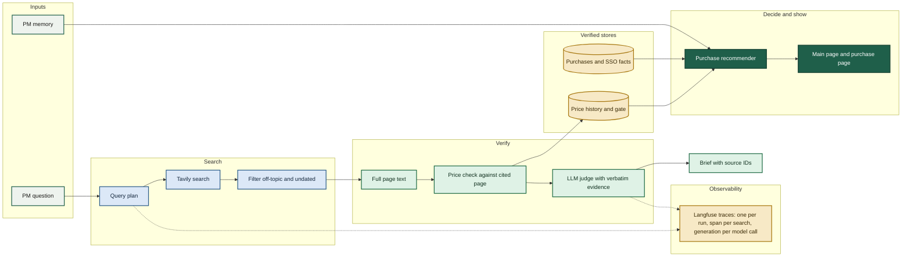

# Launch Brief to Purchase

A PM-tools evaluator and purchase recommender. It checks each price and SSO claim against the page it cites, judges the claims with an LLM, and recommends renew, negotiate, review alternatives, or insufficient data.

The starter code (`starter_agent.py`) gives one search and one model reply. Our code (`evaluator.py` and `eval/`) adds query planning, full-page price checks, a judge, a price-history store, and a purchase recommender.

## Architecture

Search and checking run in one pipeline. The purchase recommender reads only what the pipeline has verified, plus the PM's memory file. Tracing runs alongside and is off unless its keys are set.



## Results

These pages are published from this repo. They are private to the account that published them.

- **Story** (the launch brief to purchase decision, with architecture and roadmap): https://claude.ai/artifact/LhBFRmp7YKZUL6LivMdeh3
- **Results** (four tabs: starter vs ours, search outputs, evaluation, purchase recommendations): https://claude.ai/artifact/3afXof9TfKhpmUoa7kNXNw

To rebuild them locally:

```bash
python3 eval/build_ui.py              # writes eval/ui/index.html (main results page)
```

## Setup

Copy `.env.example` to `.env` and fill in:

- `TAVILY_API_KEY` (required): search and page extraction.
- `NEBIUS_API_KEY` (required): model calls for the brief and the judge.
- `LANGFUSE_PUBLIC_KEY`, `LANGFUSE_SECRET_KEY`, `LANGFUSE_BASE_URL` (optional): tracing. Leave the keys empty to turn tracing off.

`.env` is git-ignored. Do not commit keys.

## Run

```bash
python3 evaluator.py --product Linear --category "project management"   # our brief, written to runs/
python3 starter_agent.py "What does Linear cost per user?"               # the starter, for comparison
python3 tests/test_evaluator.py        # unit tests (evaluator)
python3 tests/test_recommender.py      # unit tests (recommender)
python3 tests/test_store.py            # unit tests (price store)
```

## Layout

| Path | What it holds |
|---|---|
| `evaluator.py` | Query plan, search, filters, price check, brief |
| `starter_agent.py` | The provided starter code, kept for comparison |
| `eval/llm_judge.py` | LLM judge: checks each claim against full page text |
| `eval/store.py` | Price history: gate, alerts, review queue (`eval/store/prices.db`) |
| `eval/purchases/` | Purchases, verified SSO facts, PM memory, recommender |
| `eval/build_ui.py` | Builds the results page (`eval/ui/index.html`) |
| `eval/tune/` | Hand labels, labelling rule, judge scores |
| `runs/` | Output of each evaluator run (`brief.md`, `run.json`) |
| `tests/` | Unit tests |

## Documentation

- `ENHANCEMENTS.md`: each shortcoming in the starter, the change made, the evidence, and what is still open.
- `PROGRESS.md`: the timeline and decisions, including the open live Langfuse trace check.
- `docs/search-flow.md`: side-by-side search comparison.

## Status

- Open items are listed in `ENHANCEMENTS.md` and `PROGRESS.md`.
